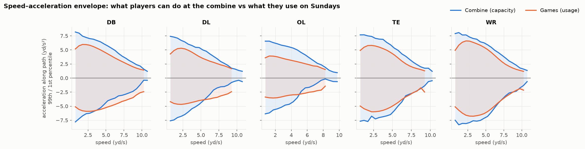
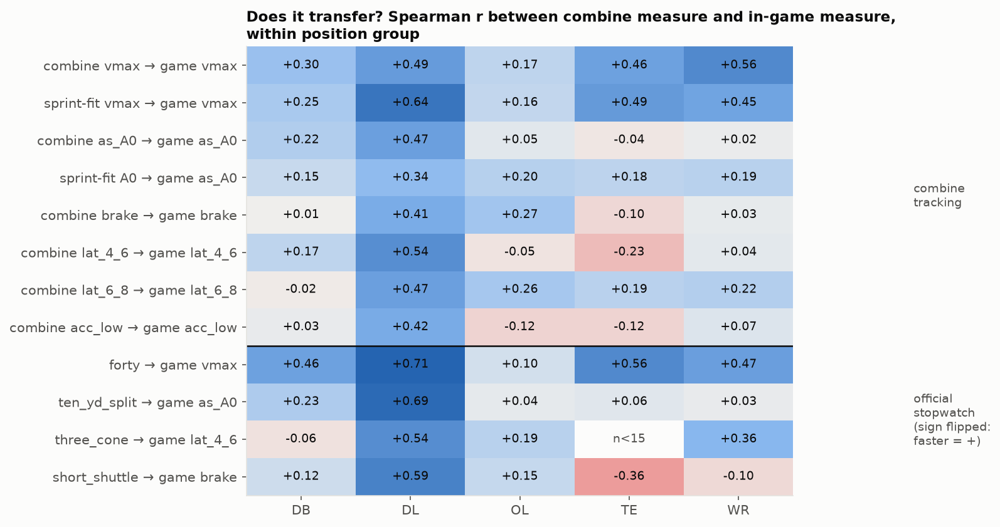
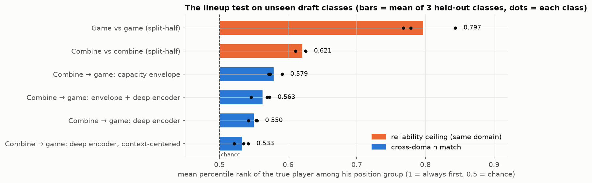
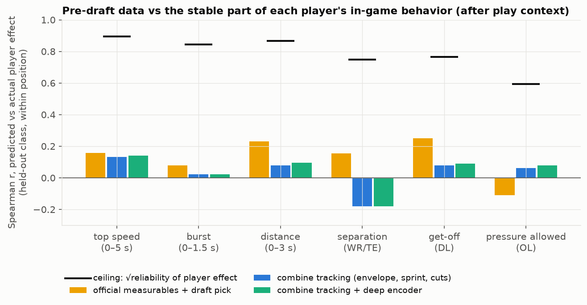
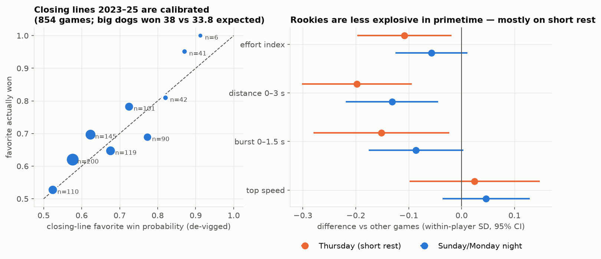
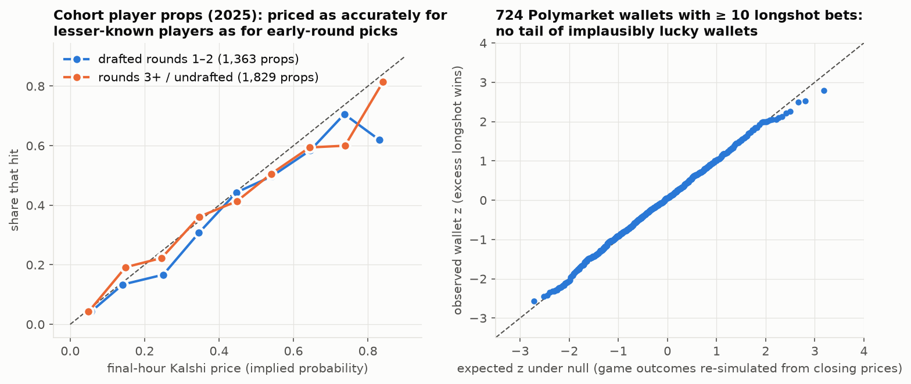

# DEEPDIVE — combine movement → Sundays, plus a betting-market layer

Built on top of [STARTER.md](STARTER.md) (Parquet cache from `notebooks/00_build_cache.ipynb`). Every number below was
produced by the scripts in `scripts/deepdive/` (run order in §0); every claim lists the script that makes it so it can be
retraced. Where something didn't work, it's written down rather than dropped.

## TL;DR

**Sensor side (the competition core)**

1. **The combine measures one thing very well: top speed.** Split-half reliability 0.86–0.90 at every position; it carries
   into games (in-game top speed, within position: WR r = 0.56, DL 0.49, TE 0.46, DB 0.30, OL 0.17).
2. **Most other combine "agility" capacities are measured too noisily to transfer** — braking, turning, low-speed
   acceleration mostly have combine reliabilities of 0.1–0.6, several not estimable at all (≈ a dozen scripted reps per
   player). **Defensive linemen are the exception:** their drills mirror their Sunday movement, and after correcting for
   noise their braking, turning and acceleration capacities transfer at r ≈ 0.6–0.98.
3. **The combine has a blind spot: braking from speed.** At ≥ 6 yd/s, hard decelerations (< −3 yd/s²) are 3.8% of game
   frames but 1.0% of combine frames — by position, games vs combine: DB 4.4% vs 0.8%, WR 4.1% vs 1.7%, DL 2.0% vs 0.2%,
   TE 1.8% vs 0.9%, OL 0.4% vs 0.01%. The combine's few hard stops come from WR/TE routes, the gauntlet and one DB drill;
   the 40, 3-cone and shuttle never produce one (F1).
4. **Deep learning: a cross-domain "movement fingerprint" encoder** (contrastive + domain-adversarial 1D CNN) shows that
   **players are highly identifiable from their in-game movement** (pick the right player out of his position group
   30% of the time from game halves vs 3% chance), but matching a player's **combine** movement to his game movement on
   unseen draft classes is only modestly above chance (within-position percentile 0.55, p ≤ 0.008 in every class) —
   and a 16-number hand-crafted capacity envelope does as well (0.58). The bottleneck is the combine itself: the
   combine fingerprint barely matches *itself* (0.62).
5. **Pre-draft data barely predict the stable part of in-game behavior.** After removing play context, player effects are
   reliable (0.35–0.80), but official measurables or combine tracking explain ~0–5% of them for unseen classes; and for
   early-career starts, **draft slot alone (R² 0.33) beats every combination with combine data.**

**Betting-market side**

6. **No evidence of informed longshot betting or of microbets/parlays bending performance.** Closing lines 2023–25 are
   calibrated (big underdogs won 38 of 179 vs 33.8 expected, P = 0.23). Of 724 Polymarket wallets with ≥ 10 pregame
   longshot bets, **zero** have implausible records after FDR, against a null that re-simulates game outcomes (0.55
   expected by chance). Large late longshot trades on cohort props won 15.0% after paying 17.0¢. Props on lesser-known
   players are priced as accurately as on early-round picks. Prop "unders" that shouldn't have happened don't coincide
   with sensor anomalies (10.6% vs 8.8%, p = 0.35).
7. **Two real side findings.** (a) **Rookies are less explosive on Thursdays** (short rest): −0.20 SD distance in the first
   3 s, −0.15 burst, robust to week, weather, home/away and dropping Week-1/Thanksgiving; not related to fame. (b) Kalshi
   **receiving-yards overs are overpriced** for cohort players (hit 4.9 points less than priced, 95% CI 0.2–9.7).

---

## 0. Reproduce

**Environment.** Deep-learning steps need PyTorch with CUDA. The project `venv/` is built on Anaconda's Python, which
ships an old MSVC runtime (14.27, 2020); torch 2.14 then fails with `OSError: [WinError 1114] … c10.dll`. So the deep
dive uses a separate **`.venv/`** (gitignored) built on python.org Python 3.11.8:

```powershell
& "$env:LOCALAPPDATA\Programs\Python\Python311\python.exe" -m venv .venv
.\.venv\Scripts\python.exe -m pip install torch --index-url https://download.pytorch.org/whl/cu126
.\.venv\Scripts\python.exe -m pip install polars pyarrow numpy scipy scikit-learn lightgbm statsmodels matplotlib requests
```

Versions used: torch 2.14.1+cu126 (RTX 3070 Laptop, 8 GB), polars 2.0.0, lightgbm 4.7.0, scikit-learn, statsmodels.

**Run order** (from `scripts/deepdive/`, `..\..\.venv\Scripts\python.exe -X utf8 <script>`); outputs go to
`data/deepdive/` (gitignored), figures to `docs/deepdive/`.

| Script | Does | Time |
|---|---|---|
| `01_kinematics.py` | frame kinematics (v, a_lon, a_lat, ω) in both domains | 30 s |
| `02_envelopes.py` | capacity envelopes, A–S profiles, 40-yd sprint fits | 1 min |
| `03_transfer.py` | same-measure transfer + stopwatch-vs-tracking CV | 1 min |
| `04_cuts.py` | change-of-direction events + cut efficiency | 1 min |
| `05_windows.py` | 3.2 s movement windows for the encoder | 1 min |
| `06_encoder.py [steps]` | contrastive encoder, 3 folds + lineup test (default 4000 steps) | 6 min (GPU) |
| `07_lineup_analysis.py` | lineup variants, split-half ceilings, per-position | 3 min |
| `08_play_models.py` | play-level LightGBM (context model is reused; single-stage result is a documented failure) | 15 min |
| `08b_player_effects.py` | two-stage player-effect transfer | 30 s |
| `09_player_games.py` | per player-game fingerprint drift + effort residuals + box score | 1 min |
| `11_player_outcomes.py` | pre-draft → early-career starts/snaps | 10 s |
| `12_reliability.py` | split-half reliability + disattenuated transfer | 1 min |
| `fetch_markets.py` | betting-market data (§B.2; written by a helper agent, see `data/markets/MARKETS_README.md`) | ~85 min first run, then cached |
| `13_market_games.py` | closing lines × sensor behavior | 1 min |
| `14_market_props.py` | Kalshi/Polymarket props, parlays, wallets, sensor link (§B.2–B.5) | 5 min |
| `10_figures.py` | all figures | 1 min |

---

## A. Sensor deep dive

### A1. One kinematics layer for both domains (`01_kinematics.py`)

Everything downstream compares a combine quantity with "the same" game quantity, so both domains go through the
identical filter: a centered Savitzky–Golay derivative (7 frames, quadratic) on x/y → velocity and acceleration vectors →
speed `v`, **along-path acceleration `a_lon`** (+ speeding up / − braking), **lateral acceleration `a_lat`** (turning;
sign = direction), **turn rate ω**. Frames whose 7-frame window spans a time gap are nulled. Combine reps use the
normalized rep frame; game plays use the direction-standardized frame, −1…+10 s around the snap.

Checks: our `v` matches the provided `s` to 0.1% in both domains. Our |a| matches the provided combine `a` (×1.04) but runs
×1.22 the provided game `a` — the game feed's `a` is smoothed more heavily. Stationary-frame noise floors are similar
(median |a| 0.79 combine vs 0.64 game), so **recomputed derivatives are the domain-consistent choice; don't mix the
provided `a` columns across domains.** Output: 431k combine frames (6,307 reps), 22.5M game frames (314k player-plays).

### A2. Capacity envelopes (`02_envelopes.py`)

Per player and domain:

- **Acceleration–speed (A–S) profile** — the in-situ method from sports science (Morin et al.): top-2 `a_lon` per 0.25 yd/s
  speed bin above 3 yd/s, linear fit `a = A0 − (A0/V0)·v`, two passes of ±2 SD outlier removal. Median fit R² 0.956
  (combine), 0.963 (games).
- **Sprint mechanical profile** from the 40: `v(t) = Vmax·(1 − e^{−(t−t0)/τ})`, A0 = Vmax/τ. 418 players; median RMSE 0.21
  yd/s, τ 1.34 s, Vmax 11.1 yd/s (3 fits hit the 13 yd/s bound — treat as outliers).
- **Ceilings**: top speed, braking (−a_lon at 3–9 yd/s), lateral acceleration at 4–6 and 6–8 yd/s, low-speed acceleration,
  turn rate. Combine = max (reps are max effort); games = 99.5th percentile (players with ≥ 50 plays: 455).



**F1** reads like a race-car g-g-v diagram: blue = what the combine shows a position can do, orange = what games use.
Two things jump out. (1) Games use far less acceleration than the combine shows at low speed — players rarely need
everything from a standstill. (2) **Below the axis the orange curve sits *outside* the blue one at speed**: players brake
harder in games than anything the combine asks of them. Confirmed directly — at v ≥ 6 yd/s, `a_lon < −3` is 3.8% of game
frames vs 1.0% of combine frames; by position (games vs combine) DB 4.35% vs 0.84%, WR 4.14 vs 1.73, DL 1.98 vs 0.22,
TE 1.83 vs 0.94, OL 0.43 vs 0.01. The combine instances come from COMEBACK/CURL routes, the GAUNTLET and DB
BACK_PEDAL_AND_TRANSITION_45; the 40, 3-cone and shuttle produce none. **Braking from speed is essentially unmeasured for
DL and OL, and under-sampled for everyone.**

### A3. Does it transfer? (`03_transfer.py`, `12_reliability.py`)



**F2**: Spearman r (within position group) between a combine measure and the same measure in games; stopwatch drills
below the line, sign-flipped so + = "faster at the combine ↔ more in games".

- Top speed transfers everywhere except OL. The official 40 does as well as tracked top speed (forty→game vmax: DL 0.71,
  TE 0.56, WR 0.47, DB 0.46).
- **Defensive linemen transfer on everything** (0.34–0.71). Everyone else transfers on almost nothing but speed.

Low transfer can mean "different trait" or "noisy measurement". Split-half reliability (combine: alternate reps; games:
odd vs even game_id; Spearman–Brown corrected) separates the two:

| | combine reliability | game reliability | observed r | disattenuated r |
|---|---|---|---|---|
| top speed, WR | 0.86 | 0.87 | 0.64 | **0.73** |
| top speed, DL | 0.89 | 0.82 | 0.47 | 0.55 |
| top speed, DB | 0.89 | 0.58 | 0.36 | 0.50 |
| braking, DL | 0.21 | 0.83 | 0.41 | **0.98** |
| turning 4–6 yd/s, DL | 0.64 | 0.82 | 0.55 | **0.76** |
| turn rate, DL | 0.41 | 0.79 | 0.49 | **0.86** |
| braking, DB | 0.22 | 0.43 | 0.06 | 0.19 |
| turning 4–6 yd/s, WR | 0.20 | 0.67 | 0.04 | 0.12 |

(players with ≥ 100 game plays, so observed r differs slightly from F2, which uses ≥ 50; full table:
`data/deepdive/reliability.parquet`; several combine reliabilities are not estimable because split-half r ≤ 0, e.g.
WR braking.) **Interpretation:** the combine measures top speed reliably and it carries over. Its agility numbers
are mostly noise at the individual level — except for DL, whose drill movements are the same physical acts as a pass
rush, so their capacity genuinely transfers. With ~100 players per group, disattenuated values are wide estimates.

Leave-one-draft-class-out ridge predicting each game capacity (within-position z-scores): for in-game top speed,
official measurables R² 0.19, combine tracking 0.19, **both 0.29** — tracking is complementary to the stopwatch for speed.
For every other capacity all three are ≤ 0.15 (`transfer_cv.parquet`).

### A4. Cut efficiency — a clean null (`04_cuts.py`)

Cut = local peak of |ω|, entry speed ≥ 2.5 yd/s, ≥ 30° turn within 1.1 s; retention = v_min / v_in and re-acceleration,
residualized on turn angle and entry speed, empirical-Bayes shrunk per player. 6,968 combine cuts, 254,929 game cuts.
Combine→game correlation ≈ 0 (DB −0.02, OL +0.03, WR +0.04; DL −0.27/+0.18). Why: combine "cuts" are plant-and-go at
low speed (median speed while turning hard is 0.6–1.8 yd/s across drill types; a ≥ 4 yd/s entry threshold found only 7
combine cuts per player), whereas game cuts happen at speed and in reaction to opponents.

### A5. Deep learning: cross-domain movement fingerprints (`05_windows.py`, `06_encoder.py`, `07_lineup_analysis.py`)

**Question:** can a model that has only seen a player at the combine pick him out of a lineup of his peers on Sundays?

- **Input:** 3.2 s windows (32 frames) of `[v, a_lon, a_lat, ω]` — rotation/translation invariant. Combine: sliding windows
  (stride 0.8 s) over every rep (27,422 windows, 510 players). Games: 0–3.2 s and 3.2–6.4 s after the snap of every
  player-play (411,196 windows, 307,538 player-plays). Augmentation: random left/right mirror (flips a_lat, ω) + noise;
  test-time mirror averaging.
- **Encoder:** dilated residual 1D CNN (8 blocks, dilations 1–8, 96 channels) → mean+max pool → 128-d L2-normalized.
- **Loss:** SupCon on player identity over mixed batches (64 players × 4 combine + 4 game windows) **+** a CLIP-style
  InfoNCE between each player's in-batch combine prototype and game prototype **+** a domain classifier behind a
  gradient-reversal layer (λ = 0.3) so the embedding can't encode "combine vs game". AdamW, cosine schedule, 4,000 steps,
  bf16; ~95 s per fold on the RTX 3070. Domain-classifier accuracy ended at 0.57–0.62 (near chance — the adversary
  works).
- **Evaluation:** leave-one-draft-class-out. For the unseen class: each player's game prototype vs every peer's combine
  prototype; metric = percentile rank of the true player **within his position group** (0.5 = chance; position is too
  easy). Null = 2,000 within-position permutations. Ceilings = split-half matching inside one domain.



| method (mean of 3 held-out classes) | within-position percentile | top-1 (chance 3%) | permutation p per class |
|---|---|---|---|
| game vs game, split-half (ceiling) | **0.797** | **30.1%** | — |
| combine vs combine, split-half (ceiling) | 0.621 | 6.7% | — |
| combine → game, capacity envelope | **0.579** | 5.5% | 0.0005 / 0.0005 / 0.0005 |
| combine → game, envelope + encoder (rank fusion) | 0.563 | 5.2% | ≤ 0.012 |
| combine → game, deep encoder | 0.550 | 3.4% | 0.001 / 0.0005 / 0.008 |
| combine → game, encoder, context-centered | 0.533 | 4.2% | 0.03 / 0.05 / 0.16 |

By position (pooled classes, encoder / envelope): **DL 0.68 / 0.70**, DB 0.54 / 0.56, WR 0.52 / 0.57, OL 0.49 / 0.52,
TE 0.49 / 0.50. The cross-domain signal is almost entirely defensive linemen — consistent with A3.

What I tried that didn't help: 300 vs 4,000 training steps (same test result; training InfoNCE kept falling from ln 64 = 4.16
to 2.7, i.e. the model memorizes the ~340 training players' cross-domain pairing rather than learning a general
mapping); context-centering (subtract the drill / role mean before averaging) made it worse, likely because game context
cells (position × route × run/pass × window) are small and noisy.

**What the encoder is good for:** the in-game fingerprint is strong and stable, so it's a usable *within-player* anomaly
detector ("is he moving like himself today?") — used in §B.

### A6. Play-level conditional transfer (`08_play_models.py`, `08b_player_effects.py`)

Given the play context (alignment, route, coverage, down/distance, clock, score, field position, season type, …), does
knowing a player's pre-draft data improve predictions of what he does on each play, for draft classes never seen?
Targets: top speed 0–5 s, burst (max a_lon 0–1.5 s), distance 0–3 s (all positions, 307,629 player-plays), separation at
pass forward (WR/TE/RB, 46k), get-off (DL, 43k), pressure allowed (OL, 60k).

**Pitfall (kept for the record):** a single LightGBM on plays with player-level columns made held-out predictions *worse*
(player-effect R² down to −2.6). With ~340 training players, player-level columns act as a player ID and the trees memorize
individual quirks. **Fix — two stages:** (1) context-only model, out-of-fold by class → residual per play; (2) per-player
mean residual, empirical-Bayes shrunk; ridge from pre-draft features, one row per player, scored *within held-out class ×
position* (class is confounded with experience, so pooled scoring mostly measures class offsets — an earlier pooled
version produced a spurious r = −0.26 for burst).



Player effects are real (split-half reliability 0.80 top speed, 0.75 distance, 0.71 burst, 0.59 get-off, 0.56
separation, 0.35 pressure allowed), but pre-draft information explains little of them: best Spearman 0.25 (get-off,
official measurables), CV R² −0.09…+0.05 everywhere. Combine tracking ≤ official measurables on every target.

### A7. Pre-draft → early-career success (`11_player_outcomes.py`)

Start rate = games started / (17 × seasons available). Leave-one-class-out ridge, within-position:

| features | start rate R² | snap rate R² |
|---|---|---|
| draft slot (log pick) | **0.334** | **0.325** |
| + official measurables | 0.318 | 0.316 |
| + combine tracking (+ encoder PCs) | 0.320 | 0.322 |
| + both | 0.294 | 0.303 |
| combine tracking only | 0.008 | 0.011 |

Teams already price athleticism into draft slot; combine tracking adds nothing on top for early-career playing time.

### A8. What this means for the writeup

The strongest, cleanest story the sensor data supports:

1. **"The combine measures speed, not agility"** — reliability decomposition (A3) + the braking blind spot (F1). Concrete,
   visual, actionable for the league (add a decel-from-speed drill; more reps per agility drill).
2. **"Defensive linemen are the exception"** — DL drills mirror the pass rush; every DL capacity transfers (A3, A5).
3. **"Players have Sunday fingerprints, not combine fingerprints"** (A5) — the encoder result is honest and novel.

Things to avoid claiming: that combine tracking predicts career success (A7) or that the deep encoder beats simple
features (A5).

---

## B. Betting-market layer

### B.0 Framing and guardrails

The question: do microbets/parlays relate to how well-known vs lesser-known players perform, and is there any statistical
sign of informed longshot betting that pays off on outcomes the numbers say shouldn't happen? This is the same screening
logic sports-integrity monitors use. Two guardrails throughout:

- **Anomaly ≠ wrongdoing.** Injuries, scheme, game script, weather and noise produce every pattern below. With thousands
  of player-games, some will look extreme by chance; everything is tested against an explicit null, at the aggregate level.
- **No individual is named as suspicious** in this doc or in anything public. Player-level flags stay in local files for
  you to inspect; a public writeup should report aggregate tests only.

### B.1 Closing lines 2023–25 × sensor behavior (`13_market_games.py`)

Source: nflverse `games.csv` closing moneylines/spreads/totals, 854 REG/POST games mapped to our `game_id` (100%).
De-vigged favorite win probability vs outcome:

| favorite prob bucket | games | expected | observed |
|---|---|---|---|
| 0.50–0.55 | 110 | 0.524 | 0.527 |
| 0.55–0.60 | 200 | 0.577 | 0.620 |
| 0.60–0.65 | 145 | 0.623 | 0.697 |
| 0.65–0.70 | 119 | 0.676 | 0.647 |
| 0.70–0.75 | 101 | 0.725 | 0.782 |
| 0.75–0.80 | 90 | 0.773 | 0.689 |
| 0.80–0.85 | 42 | 0.821 | 0.810 |
| 0.85–0.90 | 41 | 0.871 | 0.951 |
| 0.90+ | 6 | 0.912 | 1.000 |

Brier 0.210, mean vig 4.3%. Big underdogs (≤ 25%): 38 wins in 179 games vs 33.8 expected; Monte Carlo P(≥ 38) = 0.23.
**Upsets happen at the rate the closing prices imply.**

"Collapse" test: for 6,411 cohort player-games, OLS of the player's game-level **effort index** (mean of within-player z
of top-speed / burst / distance residuals vs the context model) and **fingerprint drift** (`fp_z`, cosine similarity of
the game's context-centered movement prototype to his leave-this-game-out prototype) on outcome × pregame probability,
favorite-collapse and underdog-upset flags, SEs clustered by game.

- Effort: nothing (favorite collapse −0.02, p = 0.77; underdog upset +0.02, p = 0.79). Team-game permutation within
  probability deciles (54 favorite collapses): p = 0.32.
- Fingerprint: underdog upset +0.15 (p = 0.021) and win × probability +0.34 (p = 0.023) — i.e. players on winning
  underdogs moved slightly *more* like themselves. Ten coefficients were tested; neither survives Bonferroni (0.005),
  and the collapse permutation is null (p = 0.47). Treat as noise unless it replicates.



**Betting-attention proxy × fame.** Primetime/standalone games (Thu, Mon, Sun ≥ 7 pm ET; 21% of player-games) draw the
largest betting handle. Fame = drafted in rounds 1–2. OLS with game-clustered SEs (6,086 player-games):

- Effort is lower in primetime (−0.09 SD, p = 0.010) **for famous and lesser-known rookies alike** (interaction +0.04,
  p = 0.39). Splitting the slot: Thursday −0.11 (p = 0.018), Sunday/Monday night −0.06 (p = 0.10); the component that moves
  is distance covered in the first 3 s (Thursday −0.20 SD, p < 0.001; SNF/MNF −0.13, p = 0.003) and burst (Thursday −0.15,
  p = 0.02), not top speed. The pattern (strongest on short rest, no fame interaction) points to **fatigue/rest, not
  betting attention** — and it's a nice standalone sensor finding: rookies are measurably less explosive on Thursdays.
  Robustness: adding week of season, home/away and postseason controls leaves Thursday at −0.20 distance (p < 0.001)
  and −0.15 burst (p = 0.02); week itself has no effect (p ≥ 0.23, so it's not late-season wear). Dropping Week-1 and
  Thanksgiving Thursdays (340 player-games left) *strengthens* burst to −0.18 (p = 0.004). Weather: colder games cost
  burst (+0.004 SD per °F, p = 0.001; domes/closed roofs = 70 °F), but controlling temperature and wind leaves Thursday
  at −0.19 distance (p < 0.001) and the SNF/MNF distance dip at −0.12 (p = 0.006) — the night-game dip has no rest or
  weather explanation yet (open question: kickoff time vs body clock, travel).

### B.2 What market data exists (`fetch_markets.py`; full dictionary in `data/markets/MARKETS_README.md`)

Public, read-only APIs, cached under `data/markets/raw/` (482 MB). **No sportsbook (FanDuel, DraftKings, Hard Rock, …)
data** — no free historical prop feed exists and scraping their sites violates their terms; nflverse consensus closing
lines are the only sportsbook-derived numbers. Paid historical odds/props feeds would be the way to add books.

| source | coverage | used for |
|---|---|---|
| nflverse closing lines | all 855 REG/POST games 2023–25 | B.1 |
| Kalshi markets | 191k markets, 2025 season (+ 3 title games of 2024); **player props start 2025-09-04** | props, parlays |
| Kalshi trades | 3.1M fills: full history for every cohort prop; game winners pre-kickoff only (truncated, see README) | late flow |
| Kalshi parlays (MVE) | 136k user combos (the two big series sampled pre-kickoff); 44,760 legs are cohort props, all "yes" side | parlay exposure |
| Polymarket | game winners 2023 (tiny) / 2024–25 (all 285 games each); 3.4M fills with **wallet addresses** | wallet screen |

Cohort prop coverage is the binding constraint: **83 of 510 players ever had a prop** (61 WR, 18 TE; 882 player-games,
almost all 2025). The cohort has no QBs and one RB, where most prop money is. Defensive and OL props (sacks, tackles)
exist as Kalshi series but had **zero settled markets**, so the 300+ OL/DL/DB in the cohort can't be studied through
props at all. Kalshi's curated "pre-pack" parlays (the venue-promoted ones) contain **no** cohort player props; only
user-built parlays do.

### B.3 Microbets × well-known vs lesser-known players (`14_market_props.py` P1–P2)

3,192 Kalshi cohort props with ≥ 100 contracts pregame (751 player-games, 69 players); price = volume-weighted price in
the final hour before kickoff (last pregame trade if none). Cluster bootstrap by player-game.



- Overall the yes side hit 2.2 points less than priced (95% CI −4.9…+0.5). By stat: **receiving-yards overs −4.9
  (−9.7…−0.2)**, receptions −4.0 (−9.8…+1.9), anytime TD +1.9 (−1.0…+4.9), first TD −0.1, 2+ TD −2.3.
- **Fame doesn't matter:** rounds 1–2 −3.7 (−7.7…+0.6) vs rounds 3+/undrafted −1.0 (−4.4…+2.2); logistic recalibration
  interaction p = 0.69, main effect p = 0.58. By prop-attention tercile: −0.9 / −4.9 / −0.6 (not monotonic → noise).
  Recalibration slope 0.91 — prices slightly too extreme, the usual longshot bias.
- **Parlay exposure** (user-parlay legs on that prop; median 7 among the 1,310 props with any): *more* parlayed props hit
  *more* often than priced (log-legs coefficient +0.12, p = 0.022; top-decile surprise +4.9 vs no-parlay −3.8). That is
  the opposite of "promoted parlays drag players down"; most likely parlay builders pick props with information the last
  trade price hadn't absorbed. One test — treat as a lead, not a result.

### B.4 Informed longshot flow (P3–P4)

- **Kalshi cohort props:** 89,562 pregame taker trades buying the ≤ 25¢ side. Top 1% by dollars (≥ $190) in the last 2 h:
  499 trades paid 17.0¢ on average and won 15.0% (edge −1.9 points, CI −8.9…+7.2). Big early (+0.9), small late (−0.4) and small early
  (−1.1) are all near zero. **No sign that large late longshot money knows something.**
- **Polymarket wallets, game winners 2024–25:** 56,935 pregame one-sided longshot positions (net long, average buy price
  2–30¢; wallets that bought both sides of a game are dropped as hedgers/market makers) across 27,573 wallets; 724
  wallets have ≥ 10. Per-wallet excess-wins z, Benjamini–Hochberg FDR. Null: re-simulate every *game's* winner from its
  closing price and recompute everything — this keeps the correlation between wallets that bet the same upsets (ignoring
  it is the classic way to "find" insiders). Result: **0 wallets at q ≤ 0.10** (null mean 0.55, 95th pct 2); the QQ plot
  (F6, right) sits on the diagonal. In aggregate those wallets won 51.6 more longshots than priced on 2,906 expected
  (+1.8%), P = 0.42 under the game-level null.
- **Game level:** in 569 Polymarket game markets, underdogs won 182 vs 188.3 expected. Games with ≥ $5k taker money on the
  underdog in the final 3 h (332 games) were exactly calibrated (dog win rate 33.4% vs 33.6% implied). A *shift* of late
  taker flow toward the underdog vs the prior day is weakly associated with upsets beyond the closing price (coef +0.75,
  p = 0.046) — one of ~15 tests in this section; a candidate for replication on 2026 data, not a finding.

### B.5 Sensor × market integrity screen (P5)

For cohort player-games with an over/anytime-TD prop priced ≥ 65% (181 player-games), "unlikely under" = it settled no
(66 games). Sensor anomaly = effort index ≤ −1 or fingerprint z ≤ −1.5.

- Anomaly rate in unlikely-under games 10.6% vs 8.8% in all such games; permutation p = 0.35.
- Unlikely unders that also had a late surge of "no" money (late no-share ≥ 25 points above earlier): 5. Of those, with a
  sensor anomaly: **1, vs 0.44 expected by chance.**
- Across all prop player-games, market surprise correlates weakly with effort (r = 0.07) and fingerprint (0.08) — the
  benign direction (players who fall short of their prop also ran a little less: injuries, reduced roles).

**Bottom line for the integrity question:** with the publicly available data, nothing rises above chance. That is a
meaningful negative at the market level (thousands of wallets, every game) and a weak one at the player level (83 cohort
players with props, no defensive/OL props, one season). The player-level files (`data/deepdive/prop_markets.parquet`,
`wallet_scores.parquet`, `player_games.parquet`) are local research files — don't publish names off them; every pattern
there has innocent explanations at these sample sizes.

---

## C. Open questions, issues, and what I'd do next

**Questions to resolve**

1. **Write-up angle.** Recommendation: lead with A8's three findings (speed vs agility reliability, the braking blind
   spot, DL as the exception) and use the fingerprint encoder as the novel-method piece. The market layer works best as a
   short "we looked, here's the null, here's why it's credible" section plus the Thursday finding — a well-powered null
   on insider betting is publishable; a speculative accusation is not.
2. **Preseason.** Included in the sensor analyses (the context model carries `season_type`). Preseason is 16% of plays
   and mostly backups; rerunning A5–A7 on REG/POST only is a cheap robustness check.
3. **The SNF/MNF dip** (−0.12 SD distance; not rest, not weather). Kickoff time vs body clock / travel direction is
   testable with team time zones.
4. **Combine braking proposal.** If the writeup proposes a decel-from-speed drill, the strongest evidence is F1 plus the
   DL disattenuated braking transfer (0.98): where the combine *does* see braking, it transfers.

**Known issues / limitations**

- Disattenuated correlations with ~100 players per group have wide uncertainty (and can exceed 1 by chance); they aren't
  bootstrapped yet (`12_reliability.py` is the place).
- The encoder was trained once per fold (seed 0); seed variance isn't measured. It ties a 16-feature baseline, so more
  tuning is unlikely to change the conclusion, but a 3-seed run is cheap (~5 min per seed).
- `08_play_models.py` still fits the single-stage feature sets (slow, documented failure); only its context model feeds
  08b/09. Trim it to `ctx` if runtime matters.
- Market data: Kalshi game-winner trades stop at kickoff (in-game only as hourly candles); Kalshi user parlays are a
  pre-kickoff sample via an undocumented cursor; Polymarket trades start 2023-10-25. All documented in the README.
- The cohort is rookies/young players. The integrity conclusions say nothing about veterans, QBs, RBs or star WRs —
  where nearly all prop money sits.

**Next steps if you want to push further**

1. Extend B.3/B.4 to all 546 Kalshi prop players (not just the cohort) using nflverse box scores — ~10× the power on the
   well-known vs lesser-known pricing question (no tracking needed).
2. Play-level anomaly map: the encoder can score every snap against the player's own norm; join "out-of-character"
   snaps to in-game market candles.
3. For the Kaggle notebook: port `01`–`04`, `12` and F1–F3 (CPU-only, ~5 min); present the encoder and the market layer
   as described results with code links, since Kaggle notebooks can't reproduce the market API pulls.

## Appendix — where everything lives

| path | what |
|---|---|
| `scripts/deepdive/` | all code, numbered in run order (`common.py` = paths + the shared kinematics filter) |
| `data/deepdive/` | derived tables, encoder checkpoints (`encoder_fold*.pt`), OOF embeddings, results JSON (gitignored) |
| `data/markets/` | market tables + `MARKETS_README.md` + raw API cache (gitignored) |
| `docs/deepdive/` | figures F1–F6 |
| `.venv/` | python.org-based environment for torch/CUDA (gitignored) |
- Fame doesn't change effort (p = 0.45); early-round players show more game-to-game fingerprint drift (−0.09, p < 0.001),
  which fits role variety (starters are used in more ways), not anything market-related.
