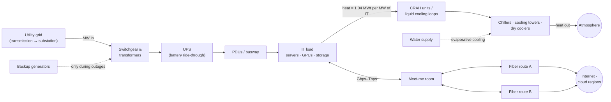

# Data Centers as Energy Systems — A Field Guide

### The lingo of capacity planning, the grid, cooling, water and fiber.

> **What this is.** A plain-language companion to the
> [Six-Site Data Center Capacity Simulator](README.md). It explains what the project does, the vocabulary
> data center and utility people use, and how that vocabulary connects to sustainability-systems ideas
> (stocks and flows, limiting factors, feedback delays, the water–energy nexus, carbon accounting).
>
> **Who it's for.** Anyone who knows some algebra and has heard of a power plant, but has never sat in a
> data center capacity review.
>
> **Synthetic data.** Every facility, number and dollar figure in the simulator is invented for demonstration.
> Order-of-magnitude statements about the real industry are flagged as such.

<!-- YOUR VOICE: 2–3 sentences on why you built this — the Upwork brief, your Sustainability Systems &
Renewable Energy master's, and the moment you realized the coursework mapped onto data centers. -->

---

## Contents

1. [The task in one page](#1-the-task-in-one-page)
2. [A data center is an energy-conversion system](#2-a-data-center-is-an-energy-conversion-system)
3. [Lexicon: electrical power](#3-lexicon-electrical-power)
4. [Lexicon: cooling, heat and water](#4-lexicon-cooling-heat-and-water)
5. [Lexicon: space and density](#5-lexicon-space-and-density)
6. [Lexicon: the utility grid](#6-lexicon-the-utility-grid)
7. [Lexicon: carbon accounting](#7-lexicon-carbon-accounting)
8. [Lexicon: data backhaul and networks](#8-lexicon-data-backhaul-and-networks)
9. [Lexicon: capacity planning and forecasting](#9-lexicon-capacity-planning-and-forecasting)
10. [What I learned in school → where it shows up in a data center](#10-what-i-learned-in-school--where-it-shows-up-in-a-data-center)
11. [The six sites as case studies](#11-the-six-sites-as-case-studies)
12. [Worked math](#12-worked-math)
13. [What the model deliberately leaves out](#13-what-the-model-deliberately-leaves-out)
14. [How to say it in a meeting](#14-how-to-say-it-in-a-meeting)
15. [Further reading](#15-further-reading)

---

## 1. The task in one page

A regional operations leader runs **six data centers** (DC1–DC6). Each one has three things that can run out:

| Resource | Unit | Runs out when… |
|---|---|---|
| **Electrical power** | MW (megawatts) | the servers plus the building's overhead draw more than the site's electrical service can deliver |
| **Cooling** | MWt (megawatts *thermal*) | the servers make more heat than the cooling plant can move outdoors |
| **Rack space** | racks | every rack position on the floor is occupied |

Demand grows every year, mostly because of AI. Adding capacity takes months to years (new utility feeds,
chillers, buildings). So the leader's real question is:

> **"Which site runs out of what, when, and what do I need to start building *today* so it arrives in time,
> within my budget?"**

The [statement of work](TASK.md) asks for a Streamlit web app that answers this. The app has four pages
(Executive Overview, Capacity Forecasting, Scenario Planning, Executive Decisions). It forecasts 6–36 months
ahead, runs what-if scenarios such as "25% growth" or "10% efficiency gain", sizes and costs expansion
projects, ranks them against a capital budget, and writes rules-based recommendations.

**What this project adds beyond the brief:** a **Monte Carlo risk layer**. Instead of "DC2 never runs out",
it can say "DC2 has a **28%** chance of running out of power within 36 months, mostly in futures where its
Phase 3 expansion slips." Single dates hide risk; probabilities show it.

---

## 2. A data center is an energy-conversion system

Strip away the servers and a data center is a machine that does three things:

1. **Takes in electricity** from the grid,
2. **Turns almost all of it into heat** (with useful computation as the by-product), and
3. **Sends data out** over fiber.

Then it has to get rid of that heat, often using water.



If you have studied energy systems, this is a **first-law (energy balance)** problem wearing a business
suit. The electricity a data center draws doesn't disappear. Effectively **100% of the power that goes into
the IT equipment comes back out as heat**, which is why the simulator ties cooling load directly to IT
power (`cooling load ≈ IT power × 1.04`; the extra 4% is fans, lighting and distribution losses inside
the room).

That one fact explains why **power and cooling are always planned together**, and why a site can be "full"
on cooling while it still has spare electrical capacity.

---

## 3. Lexicon: electrical power

| Term | Plain meaning |
|---|---|
| **MW vs MWh** | A **MW** (megawatt) is a *rate*, how hard you're pulling right now. A **MWh** (megawatt-hour) is an *amount*: 1 MW sustained for 1 hour. Capacity planning is mostly about MW (peak rate); energy bills and carbon are about MWh. |
| **IT load / critical load** | Power consumed by the servers, storage and network gear. It is the "useful" load the building exists to serve. |
| **Facility load** | IT load **plus** everything that supports it: cooling, lighting, power-conversion losses. The simulator's "power demand" is facility load. |
| **PUE** (Power Usage Effectiveness) | `total facility energy ÷ IT energy`. A PUE of **1.0** would mean zero overhead (impossible). **1.5** means 0.5 kWh of overhead for every 1 kWh of computing. Modern hyperscale sites are often around 1.1–1.2; older enterprise sites are often 1.5+ *(industry order of magnitude)*. Strictly, PUE is defined over a period of *energy*, usually a year, not as an instantaneous power ratio. |
| **Utility feed / service** | The electrical connection from the utility. Its size (in MW) is often the hardest cap on the whole site. |
| **Substation** | Where high-voltage utility power is stepped down. Big campuses often need their own substation, which can take years to build. |
| **Switchgear** | Heavy-duty breakers and switches that route and protect power within the site. |
| **UPS** (Uninterruptible Power Supply) | Batteries (or flywheels) that carry the load for the seconds to minutes between a utility outage and the generators starting. |
| **Generator** | Usually diesel backup. It runs during outages and monthly tests. It matters for air permits and Scope 1 emissions. |
| **PDU / busway** | The "power strips" of the data center: they distribute power to rows and racks. |
| **Redundancy: N, N+1, 2N** | **N** = exactly enough equipment to carry the load. **N+1** = one spare unit. **2N** = a full duplicate system (two independent paths). More redundancy means higher reliability but more installed equipment per usable MW. |
| **Tier I–IV** | Uptime Institute's reliability classes: **I** basic, **II** redundant components, **III** *concurrently maintainable* (you can service any part without shutting down), **IV** *fault tolerant* (survives any single failure). |
| **Nameplate vs usable capacity** | Nameplate is what the equipment is rated for. Usable is what you can actually sell after redundancy and safety margins. The simulator's capacity numbers are **usable**. |
| **Stranded capacity** | Capacity you paid for but can't use because a *different* resource ran out first. Example: power left over in a hall whose cooling is maxed out. |

---

## 4. Lexicon: cooling, heat and water

| Term | Plain meaning |
|---|---|
| **MWt** (megawatt thermal) | Heat removed per unit time. It is the same physical unit as MW, but the *t* reminds you it is heat, not electricity. |
| **Ton of refrigeration** | The US cooling unit: the heat needed to melt one short ton of ice in 24 hours = 12,000 BTU/h ≈ **3.517 kW**. So **1 MWt ≈ 284 tons**. Chiller catalogs are sold in tons. |
| **CRAC / CRAH** | Computer Room Air Conditioner (has its own compressor) / Computer Room Air Handler (uses chilled water from a central plant). These are the big boxes that blow cold air into the room. |
| **Chiller** | Refrigeration machine that makes chilled water for the CRAHs. It is usually the biggest single consumer of overhead power. |
| **Cooling tower** | Rejects heat by **evaporating water**. It is very energy-efficient and very water-hungry. |
| **Dry cooler / air-cooled chiller** | Rejects heat to air with fans and no evaporation. It uses little water but more electricity, especially in hot climates. |
| **Economizer / free cooling** | When outside air or water is cold enough, skip the chiller entirely. Cold climates get many free-cooling hours a year, which is a big driver of low PUE. |
| **Hot aisle / cold aisle containment** | Physically separating the cold supply air from the hot exhaust air so they don't mix. It is cheap and very effective. |
| **ASHRAE inlet envelope** | Industry guidance for server inlet air temperature. The recommended range is about **18–27 °C**. Running warmer saves cooling energy. |
| **Liquid cooling** | **Direct-to-chip** (cold plates on the processors) or **immersion** (servers submerged in fluid). It is now required for the densest AI racks, because air can't carry the heat away fast enough. |
| **WUE** (Water Usage Effectiveness) | `annual site water use (L) ÷ IT energy (kWh)`. The simulator's sites range from **0.2 L/kWh** (DC6) to **1.8 L/kWh** (DC2, a desert site using evaporative cooling). |
| **Water–energy nexus** | The trade-off at the heart of cooling design. **Evaporative cooling saves electricity but consumes water; dry cooling saves water but consumes electricity.** Which one is "sustainable" depends on whether the site's scarcer resource is water or clean power. |

---

## 5. Lexicon: space and density

| Term | Plain meaning |
|---|---|
| **White space** | The raised-floor (or slab) area where IT racks live. |
| **Gray space** | Back-of-house areas: electrical rooms, mechanical plant, generator yard. |
| **Rack** | A standard ~19-inch-wide cabinet that holds servers. Its height is measured in **rack units (U)**: 1U = 1.75 in; a full rack is typically 42–48U. |
| **Hall / data hall / pod** | A self-contained room of racks with its own power and cooling. Expansions are often built a hall at a time. |
| **kW per rack (rack density)** | How much power one rack draws. Traditional enterprise racks run around **5–10 kW**. AI GPU racks can run **tens to 100+ kW** *(industry order of magnitude)*. |
| **Densification** | Average kW per rack rising over time. It means **power demand grows faster than rack count**. The simulator models this with a 3%/yr density lever, so rack demand grows more slowly than power demand. |
| **Colocation (colo)** | A provider rents space, power and cooling to many tenants, often in a **cage** (fenced area). |
| **Hyperscale** | A giant campus run by one cloud company for its own use. |
| **Enterprise** | A company's own data center for its own systems (DC4 Harbor Point is this archetype). |

---

## 6. Lexicon: the utility grid

This is where data centers and renewable-energy coursework overlap most. A single large AI campus can draw
as much power as a small city, at an almost **flat load all day and all year**.

| Term | Plain meaning |
|---|---|
| **Generation → transmission → distribution** | Power plants produce it; high-voltage **transmission** moves it long distances; lower-voltage **distribution** delivers it locally. Big data centers often connect at transmission level. |
| **Utility / LSE** | The company obligated to serve your load (the load-serving entity). |
| **ISO / RTO** | Independent System Operator / Regional Transmission Organization, e.g. PJM, ERCOT, MISO, CAISO. They run the wholesale market and the reliability planning for a region. |
| **Interconnection** | The formal process of connecting a big new load (or generator) to the grid: studies, upgrades, agreements. |
| **Interconnection queue** | The waiting line of projects asking to connect. In many regions it now takes **years**. This is why "power is the new real estate" and why the simulator's 12-month power lead time is optimistic. |
| **Load factor** | `average load ÷ peak load`. Data centers have a very **high load factor** (they run near peak 24/7). That makes them attractive customers but hard to serve from variable renewables alone. |
| **Capacity factor** | For a *generator*: `actual output ÷ output if it ran at full power all year`. Solar is often roughly 20–25%, wind roughly 35–45%, nuclear about 90% *(order of magnitude, US)*. This mismatch with a flat data center load is the core renewable-integration problem. |
| **Capacity vs energy** | The grid sells two different things: **energy** (MWh delivered) and **capacity** (a promise to be available at peak). A data center's MW needs are a capacity problem for the grid. |
| **Demand response / flexible load** | Being paid to reduce consumption when the grid is stressed. Training workloads can sometimes pause or shift; latency-sensitive inference usually can't. |
| **Behind-the-meter (BTM)** | Generation or storage on the customer's side of the utility meter: on-site solar, batteries, fuel cells, gas turbines. |
| **PPA** (Power Purchase Agreement) | A long-term contract to buy power (often from a specific wind or solar farm). It is the main way large tech companies buy renewables. |
| **REC** (Renewable Energy Certificate) | A tradable certificate proving 1 MWh of renewable generation happened somewhere. You can buy RECs without the electrons ever reaching your site. |
| **24/7 CFE** (carbon-free energy) | Matching consumption with clean generation **every hour, on the same grid**, rather than on an annual total. It is much harder and much more meaningful than annual matching. |
| **Additionality** | Did your purchase cause *new* clean generation to be built, or did it just claim credit for existing generation? |

---

## 7. Lexicon: carbon accounting

| Term | Plain meaning |
|---|---|
| **Grid carbon intensity** | Emissions per unit of electricity, e.g. **tCO₂e/MWh**. The simulator's sites range from **0.09** (DC1, hydro-heavy Pacific Northwest) to **0.45** (DC3, coal/gas-heavy Upper Midwest). |
| **Average vs marginal emissions** | *Average* = the grid's overall mix. *Marginal* = the plant that turns on because of *your* extra load, often gas or coal. New load is marginal by definition, so average numbers usually understate its impact. |
| **Scope 1 / 2 / 3** (GHG Protocol) | **1**: direct on-site emissions (diesel generators, refrigerant leaks). **2**: purchased electricity. **3**: everything else in the value chain, including the **embodied carbon** of servers, concrete and steel. |
| **Location-based vs market-based Scope 2** | Location-based uses the local grid's average intensity. Market-based subtracts contracted clean energy (PPAs, RECs). The same building can report very different numbers. |
| **Embodied carbon** | Emissions from *making* things: building shells, chillers and especially servers, which are refreshed every few years. It is a life-cycle assessment (LCA) concept. |
| **CUE** (Carbon Usage Effectiveness) | `CO₂ emissions ÷ IT energy`, The Green Grid's carbon sibling to PUE and WUE. |
| **Carbon-aware load placement** | Running flexible work where (and when) the grid is cleanest. Section 11 shows the simulator's data supports this story. |

---

## 8. Lexicon: data backhaul and networks

Power and cooling get the attention, but a data center that can't move data is a very expensive space
heater. The simulator **does not yet model network capacity**; this section explains why it matters and
what a fourth resource would look like.

| Term | Plain meaning |
|---|---|
| **Bandwidth** | Data rate, in **Gbps / Tbps** (gigabits / terabits per second). |
| **Latency** | Delay. Light in fiber travels at about two-thirds of its vacuum speed, about **200,000 km/s**, or roughly **5 µs per km**. That works out to about **1 ms round trip per 100 km** of fiber route, before any equipment delay. Physics sets a floor no software can beat. |
| **Backhaul** | The links that carry traffic from a site *back* to the core network: internet exchanges, cloud regions, other data centers. "Backhaul requirements" means how much capacity, how many independent paths, and to where. |
| **Long-haul / middle-mile / metro / last-mile** | Fiber tiers: between cities, regional, within a metro area, and to the end customer. |
| **Dark fiber vs lit service** | **Dark**: you lease raw, unlit glass and run your own optics, which means control and capacity. **Lit**: a carrier sells you a managed bandwidth service. |
| **Route diversity** | At least two **physically separate** fiber paths, so one backhoe can't cut you off. Like electrical 2N, but for data. |
| **Carrier-neutral** | Many network providers available in the building, giving competition and redundancy. |
| **Meet-me room (MMR)** | The room where carriers and tenants physically cross-connect. |
| **IXP** (Internet Exchange Point) | A place where networks exchange traffic directly. Being close to one lowers latency and cost. |
| **Egress** | Data leaving a network. Cloud providers often charge for it, which shapes where workloads are placed. |
| **Edge** | Small sites near users for latency-sensitive work. |
| **Training vs inference siting** | **Training** a large AI model is mostly latency-*tolerant*: it can sit where power is cheap and clean, far from users, given enough backhaul for data sets. **Inference** (answering user requests) is latency-*sensitive* and wants to be near users. **This split is how network constraints and clean-energy siting meet.** |

---

## 9. Lexicon: capacity planning and forecasting

These are the terms the simulator itself uses. Formulas are in [METHODOLOGY.md](docs/METHODOLOGY.md).

| Term | Plain meaning |
|---|---|
| **Utilization** | `demand ÷ capacity`. 80% utilization = 20% left. |
| **Headroom** | `capacity − demand`, in real units (MW, MWt, racks). |
| **Compound annual growth** | Growth that builds on itself: `demand × (1 + g)^(months/12)`. At 28%/yr, demand doubles in under three years. |
| **Warning threshold (planning line)** | Default **80%**. Cross it and you should already be building. |
| **Critical threshold (operating line)** | Default **90%**. Above this, a single hot day, failed chiller or big customer move-in can cause trouble. |
| **Exhaustion** | The first month demand **exceeds** capacity. |
| **First limiting resource** | Of power, cooling and space, the one that runs out first at a given site. Fixing anything else doesn't help until that one is fixed. |
| **Lead time** | Months from "approve and order" to "capacity is live". The simulator's defaults are power 12, cooling 9, racks 3. Real utility upgrades can take far longer. |
| **Need month → commit-by month** | **Need month** = when utilization hits the warning line. **Commit-by** = need month − lead time. If commit-by is already in the past, the project **arrives late** and the site has a gap to manage. |
| **Expansion / activation month** | A planned capacity addition and the month it goes live. |
| **Scenario** | A coherent set of assumptions (growth, efficiency, budget, expansions) run through the same engine for comparison. |
| **Risk status** | Low / Medium / High / Critical, assigned by documented rules (e.g. *Critical = anything runs out within 6 months*), never by gut feel. |
| **Deterministic forecast** | One set of assumptions gives one answer. It is the "official" number. |
| **Monte Carlo simulation** | Run the same forecast **thousands of times** with random but plausible variation: growth a few points higher or lower, expansions slipping a few months, efficiency only partly achieved. Then count outcomes. |
| **P10 / P50 / P90** | Percentiles of the simulated outcomes. **P50** is the median. **P10** for an exhaustion date means "only 10% of futures run out sooner than this", a pessimistic planning date. |
| **Probability of exhaustion** | The share of simulated futures in which a site runs out within N months. It answers "how worried should I be?" where a single date can't. |
| **Correlated shocks** | In the simulator, sites share a common growth shock (a regional AI boom hits everyone at once). Ignoring correlation makes portfolios look safer than they are. |

---

## 10. What I learned in school → where it shows up in a data center

This is the bridge between sustainability-systems coursework and data center operations. Each row is an idea
from the classroom, its data center equivalent, and where the simulator uses it.

| Sustainability-systems concept | Data center equivalent | In the simulator |
|---|---|---|
| **Stocks and flows** (Meadows, *Thinking in Systems*) | Capacity is a *stock*; demand growth is a *flow* into it; expansions are inflows to capacity. | Monthly projection of demand vs capacity per site |
| **Delays in feedback loops cause overshoot** | Lead time. By the time utilization *looks* alarming, it's too late to order a 12-month utility upgrade. | Commit-by month; "arrives late" flag |
| **Liebig's law of the minimum / limiting factor** | Growth is capped by the **scarcest** resource, not the total. | First limiting resource per site |
| **Carrying capacity** | A site's usable capacity under its redundancy design. | Capacity with warning / critical thresholds |
| **Aggregation hides local limits** (ecosystem vs watershed scale) | Portfolio totals look fine while one site is in crisis. | Portfolio sits at 65% power while **DC3 runs out in month 8**. The headline KPI is the *earliest site* constraint. |
| **Energy efficiency / first-law accounting** | PUE: how much energy reaches useful work vs overhead. | Efficiency lever; per-site PUE |
| **Rebound effect / Jevons paradox** | Cheaper, more efficient compute tends to *increase* total demand. | Efficiency lever reduces demand, a known optimistic assumption worth discussing |
| **Water–energy nexus** | Evaporative cooling trades water for electricity. | Per-site WUE; DC2 in the desert at 1.8 L/kWh |
| **Renewable intermittency, capacity factor, firming** | Flat 24/7 data center load vs variable solar/wind; why 24/7 CFE is hard. | Grid carbon intensity per site |
| **Life-cycle assessment** | Embodied carbon in buildings and short-lived servers. | Not modeled; a candidate extension |
| **Resilience and redundancy** | N+1, 2N, route diversity. | Capacities treated as usable (post-redundancy) |
| **Scenario planning under deep uncertainty** (IPCC-style pathways) | Baseline / high-growth / efficiency / budget scenarios. | Five preset scenarios + Monte Carlo |
| **Multi-criteria decision analysis** | Weighing urgency, risk and cost transparently. | Priority score = 0.5·urgency + 0.3·risk + 0.2·cost |

<!-- YOUR VOICE: Add the specific courses, papers or projects from your master's that map to these rows.
Example: "In [course], we modeled ___ as a stock-and-flow system; here the stock is MW of headroom." -->

---

## 11. The six sites as case studies

All baseline numbers come from the simulator (synthetic data, as of October 2026). Each site was designed to
teach one lesson.

| Site | Story | Lesson |
|---|---|---|
| **DC1 Basalt Ridge** (Pacific NW) | 61% power, PUE 1.25, cleanest grid (0.09 tCO₂e/MWh), WUE 0.4. About **9.4 MW** of headroom. | The best place to *put* new flexible load. Low risk is an opportunity, not just "fine". |
| **DC2 Copper Mesa** (Desert SW) | Already **82% on power**, past the planning line. A 10 MW Phase 3 expansion is approved for month 12. Highest water use (WUE 1.8). | The deterministic model says it never runs out. **Monte Carlo says ~28%** chance of running out within 36 months, because in some futures Phase 3 slips. *Single dates hide schedule risk.* |
| **DC3 Prairie Junction** (Upper Midwest) | AI tenant growing **~28%/yr** on a 20 MW site, nothing planned, dirtiest grid (0.45). | **The portfolio's earliest constraint: power runs out in month 8 (Jun 2027).** A 12-month power project ordered today lands in month 12, so there is a ~4-month gap to manage. |
| **DC4 Harbor Point** (Mid-Atlantic) | Legacy enterprise site, **92% of racks occupied**, but only 73% power. PUE 1.55. | **Space-bound, not power-bound**, so there is stranded power. Cheapest fixes: consolidate onto denser servers and improve PUE. |
| **DC5 Piedmont Hollow** (Southeast) | Old cooling plant at **87%**, chiller replacement due month 9. PUE 1.6. | **Cooling-bound.** Safe only if the chiller lands on time; the summer before it does is the risky stretch. |
| **DC6 Granite Pass** (Mountain West) | New campus at 32–37% utilization on every resource. A big Phase 2 (12 MW + 800 racks) is planned for month 24. | **Over-built for now.** Phase 2 is a *deferral* candidate, and that capital could go to DC3 instead. |

**The cross-domain insight.** DC3's crisis and DC1/DC6's spare capacity are the same problem seen from two
sides. If DC3's growth is **training** load (latency-tolerant), part of it could move to DC1 (about 9 MW
spare on a grid ~5× cleaner) or DC6 (about 23 MW spare). That would buy time for DC3's expansion **and**
cut emissions. Whether that is possible depends on **backhaul** between the sites (section 8), which is
exactly why network capacity belongs in a future version of the model.

<!-- YOUR VOICE: Is there a load-migration lever you'd want to add before the pitch? It would be a strong
"how I think" demo, but it is beyond the SOW. -->

---

## 12. Worked math

### When does DC3 run out of power?

DC3 draws **17.22 MW** of a **20 MW** service and grows **28.2%** per year. Solve for the month *m* where demand
first exceeds capacity:

```
17.22 × 1.282^(m/12) > 20
1.282^(m/12)        > 20 / 17.22 = 1.1614
(m/12) × ln 1.282   > ln 1.1614
m > 12 × 0.1496 / 0.2484 ≈ 7.2      →  first whole month: m = 8  (June 2027)
```

That matches the simulator. It's the same equation as a population hitting carrying capacity under
exponential growth.

### How much heat is that, and in which units?

DC3's facility power is 17.22 MW at a PUE of 1.30, so its **IT load** is `17.22 / 1.30 ≈ 13.25 MW`.
Heat to remove ≈ `13.25 × 1.04 ≈ 13.8 MWt` (the dataset's 13.78), which is about `13.8 × 284 ≈ 3,900 tons`
of refrigeration.

### What does a PUE improvement buy?

DC4 Harbor Point: 11.69 MW facility load at PUE 1.55, so its IT load is `11.69 / 1.55 ≈ 7.54 MW`. Bringing
PUE down to 1.35 (better containment, warmer setpoints, economizers) gives the same IT load at
`7.54 × 1.35 ≈ 10.18 MW`, which frees **≈ 1.5 MW** of electrical capacity without new utility service.
Efficiency is capacity.

### Same load, different grid, very different carbon

A rough annual estimate, assuming the site runs near its current draw all year (8,760 hours):

| Site | Facility load | Annual energy | Grid intensity | ≈ Annual emissions |
|---|---:|---:|---:|---:|
| DC1 Basalt Ridge | 14.59 MW | ≈ 127,800 MWh | 0.09 t/MWh | **≈ 11,500 tCO₂e** |
| DC3 Prairie Junction | 17.22 MW | ≈ 150,800 MWh | 0.45 t/MWh | **≈ 67,900 tCO₂e** |

DC3 draws only about 18% more power but emits about **6×** the CO₂ (location-based Scope 2). **Where** load
lands matters more than how efficiently it runs.

### Water at the desert site

DC2: 24.47 MW at PUE 1.41 gives about **17.4 MW** of IT load, or about 152,000 MWh/yr of IT energy.
At WUE 1.8 L/kWh that is `152,000,000 kWh × 1.8 ≈ 274 million litres` per year, in the region where water
is scarcest.

---

## 13. What the model deliberately leaves out

Knowing a model's boundaries is part of the skill. Full list in [METHODOLOGY.md §9](docs/METHODOLOGY.md#9-limitations).

- **Smooth growth.** Real demand arrives in lumps (a tenant signs for 5 MW at once).
- **No redundancy topology.** N+1 / 2N and per-hall limits are folded into "usable capacity".
- **Optimistic grid lead times.** Real utility interconnection can take years; the Monte Carlo slip partly covers this.
- **Flat unit costs.** No economies of scale, inflation or financing, and no ROI claims.
- **Efficiency applied to all demand.** In reality, PUE gains cut overhead, not IT load. Also see Jevons above.
- **No network, carbon-cost or water constraints.** The dataset carries carbon intensity and WUE for the
  sustainability view, but they don't yet limit growth.
- **Synthetic data only.** The numbers are realistic in shape, not measured.

---

## 14. How to say it in a meeting

**One sentence.**
"It forecasts when each of six data centers runs out of power, cooling or space, tells you what to build and
when to order it, and puts odds on the dates so you can see schedule risk, not just a single guess."

**For an operations director.**
"Portfolio utilization is 65%, which sounds fine, but Prairie Junction runs out of power in June 2027, and a
power project ordered today won't land until October. That's a four-month gap to cover. Meanwhile Granite
Pass has 23 MW idle and a Phase 2 we could defer."

**For a sustainability lead.**
"Moving flexible training load from Prairie Junction to Basalt Ridge cuts its grid intensity about 5× and
buys time for the expansion. Copper Mesa is our water-risk site: 1.8 L/kWh in the desert."

**For a hiring manager.**
"I treated it as a systems problem: stocks and flows, a limiting-factor rule, feedback delays from lead
times, and a Monte Carlo layer on the same engine so the 'official' numbers and the risk view can't
disagree. It's tested against hand-worked cases."

<!-- YOUR VOICE: Rewrite these in your own cadence; these are scaffolding. -->

---

## 15. Further reading

- **Donella Meadows**, *Thinking in Systems: A Primer*: stocks, flows, delays, leverage points.
- **The Green Grid**: the original definitions of PUE, WUE and CUE.
- **Uptime Institute**: the Tier Standard and its annual global data center survey.
- **ASHRAE TC 9.9**: thermal guidelines for data processing environments.
- **Lawrence Berkeley National Laboratory**, *2024 United States Data Center Energy Usage Report*.
- **International Energy Agency**, *Energy and AI* (2025).
- **EPRI**, *Powering Intelligence* (2024): data center load growth and grid implications.
- **GHG Protocol**, *Scope 2 Guidance*: location-based vs market-based accounting.

---

*Part of the [Six-Site Data Center Capacity Simulator](README.md). Synthetic data, for demonstration only.*
